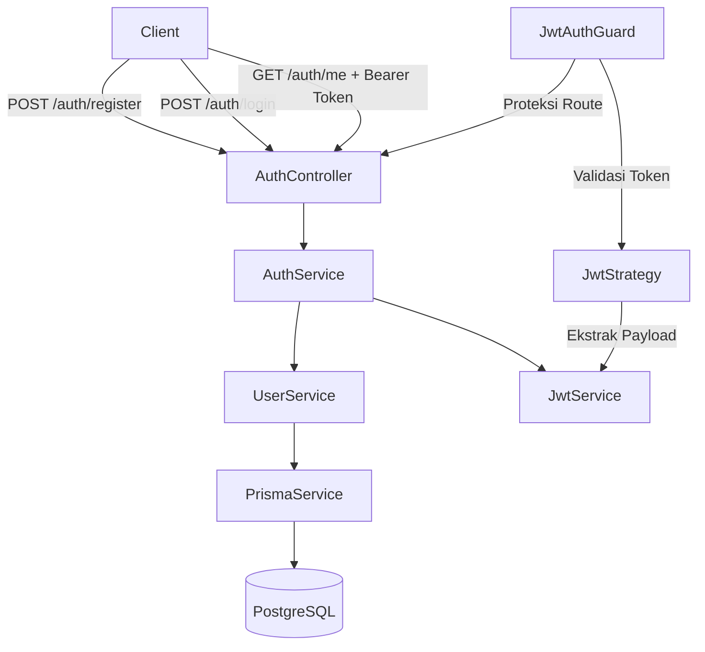
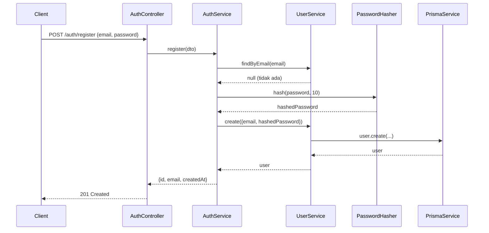
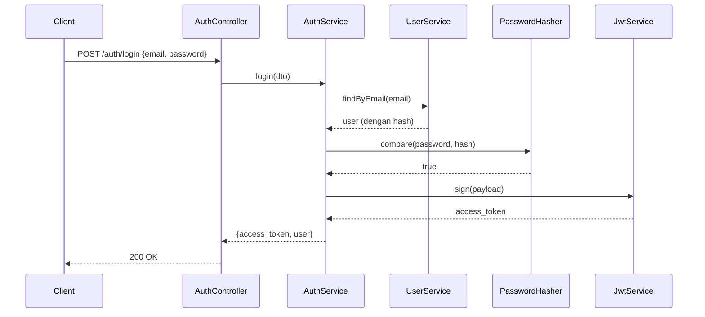

# Dokumen Design: Backend Authentication

## Overview

Sistem autentikasi backend dibangun menggunakan NestJS dengan arsitektur modular. Terdapat dua modul utama: `AuthModule` dan `UserModule`. Autentikasi menggunakan JWT (JSON Web Token) yang diterbitkan saat login berhasil, dan divalidasi menggunakan Passport.js JWT Strategy pada setiap request ke route yang diproteksi. Password disimpan menggunakan bcrypt hash. Database menggunakan PostgreSQL yang diakses melalui Prisma ORM.

---

## Arsitektur



### Alur Registrasi



### Alur Login



---

## Komponen dan Interface

### AuthModule

```typescript
@Module({
  imports: [
    UserModule,
    PassportModule,
    JwtModule.registerAsync({
      useFactory: (config: ConfigService) => ({
        secret: config.get("JWT_SECRET"),
        signOptions: { expiresIn: "7d" },
      }),
      inject: [ConfigService],
    }),
  ],
  controllers: [AuthController],
  providers: [AuthService, JwtStrategy],
})
export class AuthModule {}
```

### UserModule

```typescript
@Module({
  imports: [PrismaModule],
  providers: [UserService],
  exports: [UserService],
})
export class UserModule {}
```

### AuthController

Endpoint yang disediakan:

| Method | Path           | Guard        | Deskripsi                       |
| ------ | -------------- | ------------ | ------------------------------- |
| POST   | /auth/register | -            | Registrasi pengguna baru        |
| POST   | /auth/login    | -            | Login dan mendapatkan JWT token |
| GET    | /auth/me       | JwtAuthGuard | Mendapatkan data pengguna aktif |

### AuthService

```typescript
interface IAuthService {
  register(dto: RegisterDto): Promise<UserResponse>;
  login(dto: LoginDto): Promise<LoginResponse>;
  getMe(userId: string): Promise<UserResponse>;
}
```

### UserService

```typescript
interface IUserService {
  findByEmail(email: string): Promise<User | null>;
  findById(id: string): Promise<User | null>;
  create(data: CreateUserData): Promise<User>;
}
```

### JwtStrategy

Mengextend `PassportStrategy(Strategy)` dari `@nestjs/passport`. Memvalidasi token dari header `Authorization: Bearer <token>` dan mengembalikan payload ke `request.user`.

### JwtAuthGuard

Mengextend `AuthGuard('jwt')` dari `@nestjs/passport`. Digunakan sebagai decorator `@UseGuards(JwtAuthGuard)` pada route yang memerlukan autentikasi.

---

## Data Models

### Prisma Schema

```prisma
model User {
  id        String   @id @default(uuid())
  email     String   @unique
  password  String
  createdAt DateTime @default(now())
  updatedAt DateTime @updatedAt
}
```

### DTO (Data Transfer Objects)

```typescript
// RegisterDto
class RegisterDto {
  @IsEmail()
  email: string;

  @MinLength(8)
  password: string;
}

// LoginDto
class LoginDto {
  @IsEmail()
  email: string;

  @IsNotEmpty()
  password: string;
}
```

### Response Types

```typescript
// UserResponse (tanpa password)
interface UserResponse {
  id: string;
  email: string;
  createdAt: Date;
  updatedAt: Date;
}

// LoginResponse
interface LoginResponse {
  access_token: string;
  user: UserResponse;
}

// JWT Payload
interface JwtPayload {
  sub: string; // userId
  email: string;
  iat?: number; // issued at (otomatis)
}
```

---

## Correctness Properties

_A property adalah karakteristik atau perilaku yang harus berlaku di semua eksekusi valid dari sebuah sistem — pada dasarnya, pernyataan formal tentang apa yang seharusnya dilakukan sistem. Properties berfungsi sebagai jembatan antara spesifikasi yang dapat dibaca manusia dan jaminan kebenaran yang dapat diverifikasi oleh mesin._

### Property 1: Hash password tidak pernah sama dengan plaintext

_Untuk setiap_ string password yang valid, hasil hash bcrypt tidak boleh sama dengan string password aslinya.

**Validates: Requirements 3.1, 3.2**

---

### Property 2: Verifikasi password round-trip

_Untuk setiap_ password plaintext yang valid, melakukan hash lalu memverifikasi dengan `bcrypt.compare` harus selalu mengembalikan `true`.

**Validates: Requirements 3.3**

---

### Property 3: Hash berbeda untuk password yang sama

_Untuk setiap_ password yang sama, dua operasi hashing yang berbeda harus menghasilkan hash yang berbeda (karena salt acak).

**Validates: Requirements 3.2**

---

### Property 4: JWT payload round-trip

_Untuk setiap_ payload yang valid (`sub`, `email`), menandatangani lalu mendekode token harus menghasilkan payload yang ekuivalen dengan input awal.

**Validates: Requirements 4.1, 4.2**

---

### Property 5: Token kedaluwarsa ditolak

_Untuk setiap_ JWT token yang sudah melewati masa berlakunya, validasi token harus selalu mengembalikan error Unauthorized.

**Validates: Requirements 4.5**

---

### Property 6: Registrasi dengan email duplikat selalu ditolak

_Untuk setiap_ email yang sudah ada di database, percobaan registrasi ulang dengan email yang sama harus selalu menghasilkan error 409 Conflict.

**Validates: Requirements 1.2**

---

### Property 7: Response tidak mengandung password

_Untuk setiap_ response dari endpoint `/auth/register`, `/auth/login`, dan `/auth/me`, field `password` tidak boleh ada di dalam response body.

**Validates: Requirements 1.6, 2.4, 6.3**

---

### Property 8: Validasi input registrasi

_Untuk setiap_ kombinasi email tidak valid atau password kurang dari 8 karakter, request registrasi harus selalu ditolak dengan HTTP 400.

**Validates: Requirements 1.3, 1.4**

---

## Error Handling

| Kondisi                             | HTTP Status | Pesan                               |
| ----------------------------------- | ----------- | ----------------------------------- |
| Email sudah terdaftar               | 409         | "Email sudah terdaftar"             |
| Email/password tidak valid (format) | 400         | Pesan validasi dari class-validator |
| Kredensial salah saat login         | 401         | "Kredensial tidak valid"            |
| Token tidak ada / tidak valid       | 401         | "Unauthorized"                      |
| Token kedaluwarsa                   | 401         | "Unauthorized"                      |
| Resource tidak ditemukan            | 404         | "Pengguna tidak ditemukan"          |

Semua error dikembalikan dalam format standar NestJS:

```json
{
  "statusCode": 401,
  "message": "Kredensial tidak valid",
  "error": "Unauthorized"
}
```

---

## Testing Strategy

### Pendekatan Dual Testing

Pengujian menggunakan dua pendekatan yang saling melengkapi:

1. **Unit Tests**: Memverifikasi contoh spesifik, edge case, dan kondisi error
2. **Property-Based Tests**: Memverifikasi properti universal di berbagai input yang di-generate secara acak

### Library

- **Unit Testing**: Jest (sudah terintegrasi dengan NestJS)
- **Property-Based Testing**: `fast-check` (library PBT untuk TypeScript/JavaScript)

### Unit Tests

Fokus pada:

- Contoh spesifik yang mendemonstrasikan perilaku benar
- Integrasi antar komponen (AuthService ↔ UserService ↔ PrismaService)
- Edge case dan kondisi error (email duplikat, password salah, token invalid)

Contoh test cases:

- `register()` berhasil dengan data valid → mengembalikan user tanpa password
- `register()` gagal dengan email duplikat → throw ConflictException
- `login()` berhasil → mengembalikan access_token dan user
- `login()` gagal dengan password salah → throw UnauthorizedException
- `JwtAuthGuard` menolak request tanpa token → 401

### Property-Based Tests

Konfigurasi: minimum **100 iterasi** per property test.

Setiap property test harus diberi tag komentar:

```
// Feature: backend-authentication, Property N: <deskripsi property>
```

| Property   | Deskripsi                        | Implementasi                                                                           |
| ---------- | -------------------------------- | -------------------------------------------------------------------------------------- |
| Property 1 | Hash tidak sama dengan plaintext | `fc.string()` → hash → assert hash !== plaintext                                       |
| Property 2 | Verifikasi round-trip            | `fc.string()` → hash → compare → assert true                                           |
| Property 3 | Hash berbeda untuk input sama    | `fc.string()` → hash dua kali → assert hash1 !== hash2                                 |
| Property 4 | JWT payload round-trip           | `fc.record({sub: fc.uuid(), email: fc.emailAddress()})` → sign → decode → assert equal |
| Property 5 | Token expired ditolak            | Generate token dengan expiry lampau → validate → assert 401                            |
| Property 6 | Email duplikat selalu ditolak    | Register email → register lagi → assert 409                                            |
| Property 7 | Response tanpa password          | Arbitrary user data → register/login → assert no `password` field                      |
| Property 8 | Input invalid selalu ditolak     | `fc.string()` non-email atau password < 8 char → assert 400                            |
